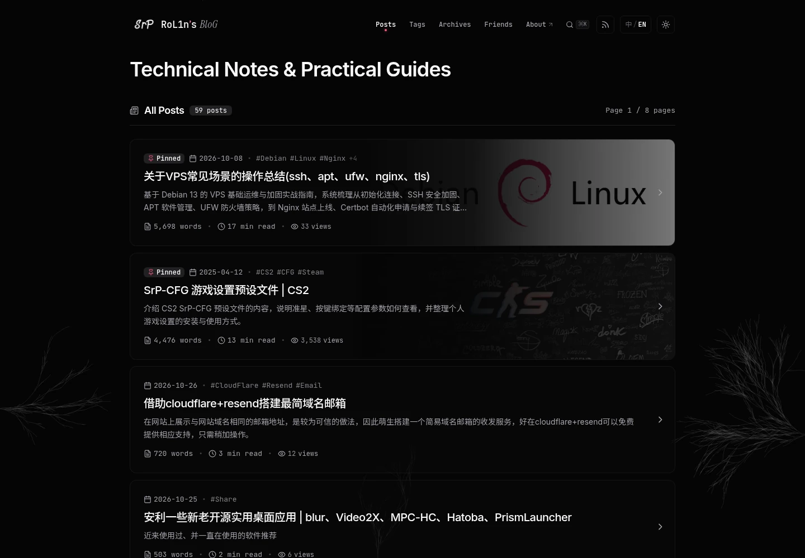
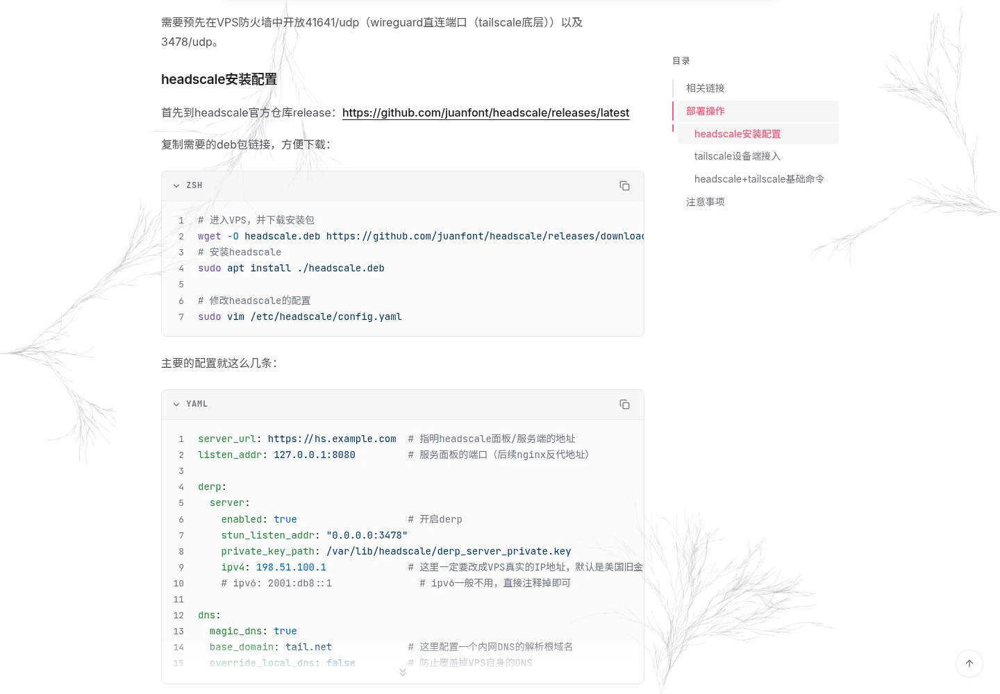
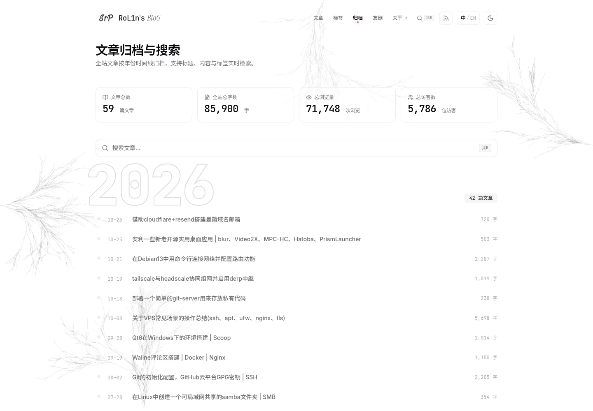
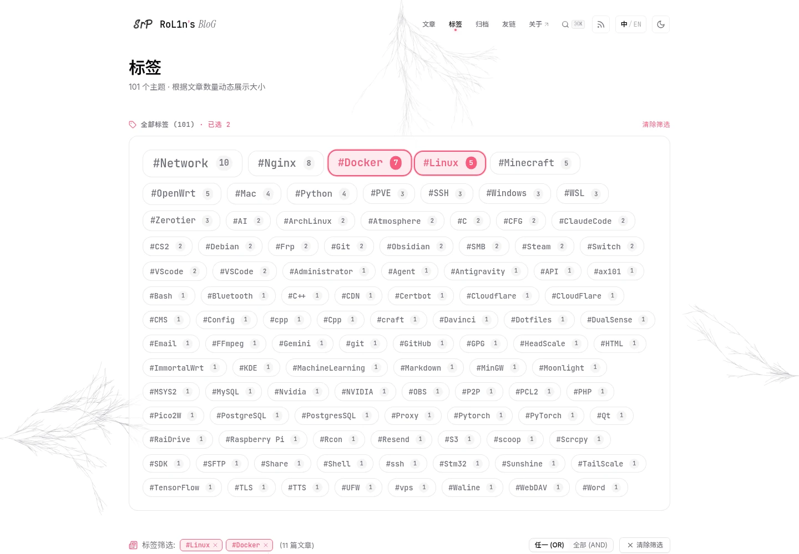
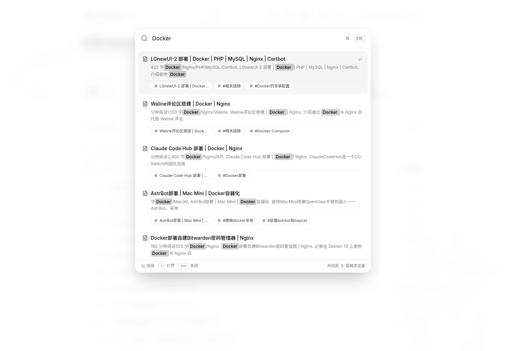
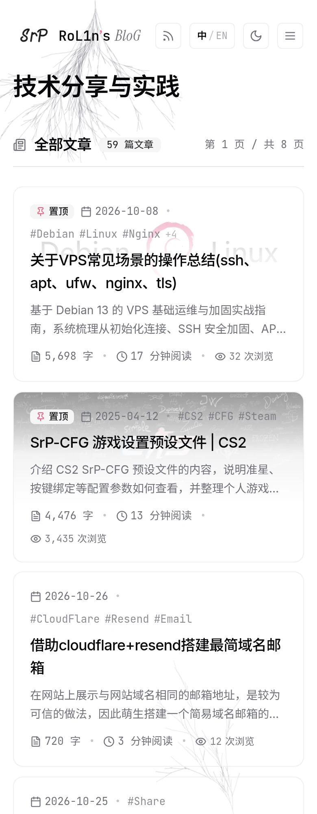
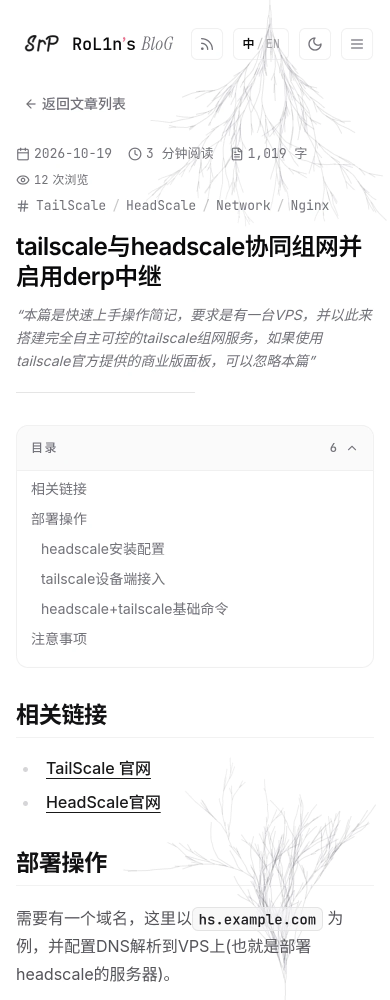

<h1 align="center">SrP-BloG</h1>

<h4 align="center">基于 Vite 与 React Router 构建、全站预渲染的现代化个人技术博客</h4>

<div align="center">

[](https://github.com/RolinShmily/SrP-BloG)

[](https://vite.dev/)
[](https://reactrouter.com/)
[](https://workers.cloudflare.com/)

<br>

[English](README.md) | [简体中文](README.zh-CN.md)

</div>

---

## 界面预览


<details>
<summary>展开更多截图：深色模式、文章阅读、归档、标签、搜索与手机端</summary>

### 深色模式与英文界面



### 文章阅读



### 文章归档



### 标签筛选



### 全文搜索



### 手机端布局

<p align="center">
  
  
</p>

</details>

---

## 🌟 特性

- **纯静态预渲染**：基于 Vite + React Router（框架模式，`ssr: false`），全站路由预渲染为 HTML，极速加载，零服务端运行时。
- **单源 Markdown**：`content/posts/<slug>/index.md`，一文一目录，图片等资源同目录就近存放并自动同步。
- **可视化内容管理 (Sveltia CMS)**：集成原生 Git 存储的无头 CMS，位于 `/admin` (`public/admin/`)，支持文章、友链与赞助的可视化编辑，由独立的静态文件配置驱动。
- **现代化互动评论 (Waline)**：文章详情页与友链页面无缝嵌入 Waline 评论区，支持微博/Bilibili 表情包、Markdown 语法与深浅双色自适应主题定制，支持 `siteConfig.comment.enabled` 一键启闭。
- **现代化设计**：基于 shadcn Zinc 风格，内置卡片光标微光（Card Spotlight）、冬梅背景画布 (`ArtPlum`)、平滑转场与自适应暗色模式。
- **自托管字体**：Inter、Noto Sans SC、JetBrains Mono 与 Instrument Serif 在构建时下载并由本站源站提供，按 unicode-range 切片加载，运行时不再依赖 Google Fonts。
- **轻量双语**：UI 界面支持中英即时切换，无额外路由前缀与重复构建开销。
- **全方位 SEO 与统计**：原生集成 Google Analytics 4 (GA4)、Google Search Console 与 Bing Webmaster 的 Meta 标签鉴权，集成 IndexNow 增量实时推送到搜索引擎。
- **隐私统计 (UPV)**：可选基于 Cloudflare Workers + D1 的独立统计服务，加盐哈希去重，不存明文 IP，未配置时静默降级。
- **全文智能检索 (Pagefind)**：基于 Rust 打造的客户端离线全文索引引擎，支持 `Cmd+K` / `Ctrl+K` 全局快捷键呼出、关键词上下文片段高亮（Snippet）、分块渐进加载与中英文分词检索。
- **动态社交分享卡片 (Satori)**：基于 Vercel Satori 与 Sharp 构建期预渲染，为每篇文章生成 1200×630 高清专属社交分享图（macOS 极客视窗风格，含标题、标签与阅读时长）。
- **开箱即用**：多标签过滤、RSS 2.0、Sitemap 与友链自动校验工作流。

---

## 📚 文档

文档按关注点划分：

- [架构规范](docs/architecture.md) — 渲染模型、构建管线、数据流与部署拓扑。
- [设计规范](docs/design.md) — 视觉语言、字体、布局、动效与可访问性。
- [开发规范](docs/development.md) — 环境、编码约定、内容流程与提交前检查。
- [参考规范](docs/reference.md) — 命令、环境变量、站点配置与内容 schema。
- [截图目录](docs/screenshot/) — README 使用的界面截图。

---

## 📁 目录结构

```
├── content/              # 内容源：posts/ (文章)、friends/ (友链)、sponsors/ (赞助)
├── docs/                 # 项目文档（架构/设计/开发/参考）与 README 截图
├── public/               # 静态资源与自动生成的封面、字体、搜索索引
├── scripts/              # 构建脚本 (资源同步、字体、OG 卡片、搜索索引、校验等)
├── services/cms/         # Sveltia CMS 的独立 GitHub OAuth 认证服务 (Cloudflare Workers)
├── services/upv/         # 可选的独立 PV/UV 统计服务 (Cloudflare Workers + D1)
├── src/                  # 核心源码 (router, components, config, i18n, lib)
├── CONTRIBUTING.md       # 贡献指南 (友链、勘误、代码、提交前检查)
├── LICENSE               # MIT 源码许可
├── THIRD_PARTY_NOTICES   # 第三方声明 (搬运源码、Web 字体、Pagefind 运行时)
└── .github/workflows/    # CI/CD 自动化 (部署、IndexNow、友链校验)
```

---

## ⚡ 快速上手

```bash
pnpm install --ignore-scripts # 安装依赖（不执行生命周期脚本）
pnpm dev                # 启动 Vite 开发服务 (http://localhost:5173)
pnpm build              # 静态预渲染构建 (产物位于 build/client/)
pnpm typecheck          # 生成路由类型并运行 tsc --noEmit
pnpm lint               # 代码规范检查
pnpm verify-content     # 内容管线完整性校验 (85 项检测)
pnpm fonts              # 刷新自托管字体缓存（dev/build 会自动执行）
pnpm new-post -- <slug> # 创建新文章模板目录
```

> 首次 `pnpm dev` / `pnpm build` 会把自托管字体（约 5 MB）下载到 `public/fonts/`（已 gitignore），后续构建直接复用；需要强制刷新时运行 `pnpm fonts -- --force`。

---

## ✍️ 写作说明

使用 `pnpm new-post -- <slug>` 或在 `content/posts/` 下新建目录，**目录名即为文章 slug**：

```markdown
---
title: 文章标题
published: 2026-01-01
updated: 2026-01-01      # 必填，且不得早于 published
description: 文章简介（用于摘要、搜索与 SEO）
image: ./cover.png       # 可选：同目录下图片相对路径
tags: [Vite, Web]        # 可选：标签
draft: false            # 为 true 时不发布
pinned: false           # 为 true 时在首页置顶
---

Markdown 正文...
```

> **图片就近存放**：引用图片直接放在文章目录下（如 `./cover.png`），构建时自动同步至静态目录，并由 `sharp` 压缩为 768px 的 WebP 卡片缩略图（`<name>.thumb.webp`，体积约减少 95%）——CI 工作流将该步骤独立执行。若构建环境无法运行缩略图步骤，请在 `src/config/site.ts` 中设置 `cardThumbnail: false`，卡片将回退使用原图。

---

## ⚙️ 站点配置

全局配置统一收拢在 [`src/config/site.ts`](./src/config/site.ts)，集中维护全站核心元数据与服务集成开关：

- **基础与展示**：站点标题、作者身份、社交媒体链接、ICP 备案号、友链申请信息及页脚技术栈。
- **互动评论 (`comment`)**：集成 Waline 评论区，支持配置服务端 URL 及全站一键启闭。
- **SEO 与站长生态 (`seo`)**：集成 Google Analytics 4、Google Search Console、Bing Webmaster 鉴权及 IndexNow 实时推送。
- **隐私统计 (`upv`)**：集成自建 Cloudflare Workers + D1 的 PV/UV 统计服务 API。
- **图片优化 (`cardThumbnail`)**：卡片封面使用构建期 `sharp` 生成的 WebP 缩略图，无法运行缩略图步骤时可关闭并回退原图。

---

## 🌐 部署与 CI/CD

### 1. 博客静态部署 (Cloudflare Workers)

通过 `.github/workflows/deploy.yml` 自动构建部署：

- 在 GitHub 仓库中配置 Secrets：`CLOUDFLARE_API_TOKEN` 与 `CLOUDFLARE_ACCOUNT_ID`。
- 推送至 `main` 分支即可自动执行 Vite/React Router 预渲染并部署至 Cloudflare Workers（基于 `wrangler.jsonc` 静态资产托管，目录为 `build/client/`）。

### 2. （可选）UPV 统计服务与 D1 迁移

统计服务位于 `services/upv/`：

```bash
cd services/upv && cp .dev.vars.example .dev.vars
npm run db:schema                  # 初始化 D1 表结构
npx wrangler secret put SALT       # 配置加盐哈希密钥
npm run deploy                     # 部署 Worker
```

部署后在 `src/config/site.ts` 中配置 `upv.api` 即可。

**D1 版本化迁移（Wrangler Migrations）**：

```bash
npm run db:migrate:create -- <name> # 创建迁移文件 (migrations/0001_<name>.sql)
npm run db:migrate:local            # 本地沙箱测试
npm run db:migrate:remote           # 部署到线上 D1
npm run db:migrate:list             # 查看迁移状态
```

### 3. CMS GitHub OAuth 认证服务

`/admin/` 的 Sveltia CMS 通过独立的 [`services/cms/`](./services/cms/README.md) Worker 登录 GitHub，
认证域名示例为 `auth.example.com`，OAuth App 回调地址示例为 `https://auth.example.com/callback`。
请将 `services/cms/wrangler.toml` 和 `public/admin/config.yml` 中的域名同步替换为自己的域名；
接管已有 Worker 时，保留其实际名称。

- 新增仓库 Secrets：`CMS_GITHUB_CLIENT_ID`、`CMS_GITHUB_CLIENT_SECRET`，并复用已有 Cloudflare 部署 Secrets。
- `.github/workflows/cms.yml` 在 PR 中执行 OAuth 测试与 dry run，只在 `main` 上部署认证服务。
- 仅修改 CMS 服务时跳过博客和 IndexNow 整站构建；通过 CMS 保存文章仍正常触发博客发布。
- 服务无运行时依赖；在 `services/cms/` 下运行 `npm test` 可执行模拟认证测试。

---

## 🤝 友链申请

在 `content/friends/<站点名>.json` 下新增单对象文件后提交 PR，GitHub Actions 将自动完成可达性与双向链接校验：

```json
{
  "name": "站点名称",
  "url": "https://example.com",
  "description": "一句话介绍",
  "avatar": "https://example.com/avatar.png",
  "backlink": "https://example.com/friends/"
}
```

更多贡献方式（文章勘误、代码与界面改进）与提交前必须通过的检查见 **[CONTRIBUTING.md](./CONTRIBUTING.md)**。

---

## 📄 开源协议与致谢

- **源代码**（`src/`、`scripts/`、`services/upv/`、构建与部署配置及文档）：**[MIT License](./LICENSE)**。
- **原创文章与媒体**（`content/**` 及 `public/` 下的原创素材）：**[CC BY-NC-SA 4.0](https://creativecommons.org/licenses/by-nc-sa/4.0/)**；站点名称、域名、头像与品牌标识不在 MIT 授权范围内。
- **第三方代码与分发资产**（改写的 `sveltia-cms-auth`、OFL-1.1 Web 字体与 Pagefind 运行时）：见 **[THIRD_PARTY_NOTICES](./THIRD_PARTY_NOTICES)**。
- **界面参考与致谢**（仅设计参考，未搬运源码）：[cworld1/astro-theme-pure](https://github.com/cworld1/astro-theme-pure)（Apache-2.0）、[Dancncn/DansBlog](https://github.com/Dancncn/DansBlog)（MIT）、[antfu/antfu.me](https://github.com/antfu/antfu.me)（MIT）。
