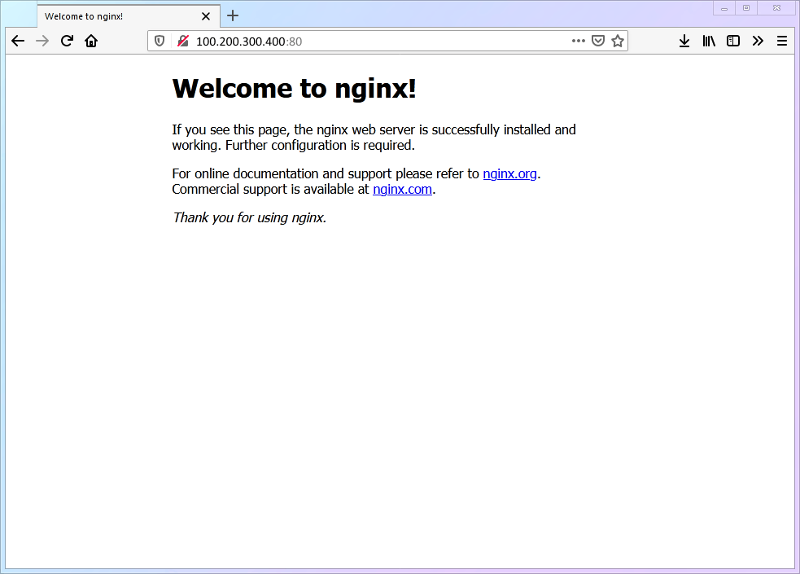

# 相关链接

- [Debian 官方手册与文档](https://www.debian.org/doc/)

- [OpenSSH 官方使用手册](https://www.openssh.com/manual.html)

- [UFW (Uncomplicated Firewall) 官方文档](https://wiki.ubuntu.com/UFW)

- [Nginx 官方文档](https://nginx.org/en/docs/)

- [Certbot 官方使用指南与插件文档](https://certbot.eff.org/)

- [Filesystem Hierarchy Standard (FHS 规范手册)](https://refspecs.linuxfoundation.org/FHS_3.0/fhs/index.html)

本篇以`Debian13`操作系统作为讲解基础，按照行文顺序进行操作，可以基本了解Linux的一些基础操作。

# SSH
这是一个很难绕开的问题，也往往是VPS的开端，我们购买了一个VPS，一般厂商会提供用户名`root`，以及随机密码`<root_passwd>`，这时我们随手打开**Terminal**，诸如`Powershell`、`Git Bash`以及Linux、MacOS自带的终端界面，输入如下指令来连接VPS：
```zsh
# server.ipv4为需替换字段
ssh root@server.ip
# 默认走22/tcp端口
ssh root@server.ip -p 22
```

#  APT
在Debian系(含Ubuntu)的操作系统上，**包管理器**为`apt`，旧时则有`apt-get`，顾名思义，这是一种管理 软件的“软件”，也就是“应用商店”，可以进行软件的安装、卸载、更新等。
```zsh
# 更新apt软件列表
apt update
# 执行更新软件包 
apt upgrade
# 也可以放在一起
apt update && apt upgrade
```

# UFW
`ufw`是一个防火墙工具，运行在操作系统上，而云厂商的**安全组**才是第一道关卡，但一些VPS厂商对**安全组**的策略比较放松，也即**允许**所有入站、出站流量，相当于裸奔，这就需要我们自己在VPS上进行防火墙配置。
```zsh
# 查找ufw
apt search ufw
# 若没有，则安装
apt install ufw 
```
首先，我们需要对SSH端口进行放行，默认的`22`是常见的被扫描端口，因此可以改成不常见(非也)的`2222`，此时我们还没有运行`ufw`。
```zsh
# 放行22、2222/tcp端口
ufw allow 22/tcp
ufw allow 2222/tcp
# 默认拒绝入站，允许出站
sudo ufw default deny incoming
sudo ufw default allow outcoming
# 启动ufw
ufw enable
# 查看状态
ufw status verbose
# 删除策略：“放行22/tcp端口”
ufw delete allow 22/tcp
```

# 修改SSH配置
我们需要将SSH默认端口改为`2222`，并禁止`root`登录。
```zsh
# 进入配置目录
cd /etc/ssh
# 编辑配置文件
nano sshd_config
```
`nano`是一个文本编辑器，相关快捷键如下：
- `ctrl+w`搜索
- `ctrl+o`+`Enter`保存
- `ctrl+x`退出
我们更改配置文件行为：`Port 2222`、`PermitRootLogin no`

# User、Group
在一般情况下，`root`作为最高权限用户，最好不要在**Dev**环境中长期使用，这会淡薄权限意识，也会造成不可挽救的麻烦，因此一个**临时拥有**最高权限的**普通**用户，就很有必要作为日常操作的主要角色。
```zsh
# -m 创建/home/rolin家目录，-s 指定用户shell环境，rolin为可替换字段
useradd  -m  -s  /bin/bash rolin
# 设置密码
passwd rolin
# 加入用户管理员组（debian系为sudo、arch为wheel）
usermod -aG sudo rolin
```
> Terminal 是 Shell 的人机交互界面，负责输入和输出；Shell 是命令解释器，负责解析命令并执行内建命令或启动外部程序。

# Sudo
`sudo`意味super-do，可以临时变成`root`用户进行操作。
```zsh
# 安装sudo
apt install sudo
# 使用visudo编辑/etc/sudoers
visudo
```
这里需要编辑行，使得`sudo`用户组具备`sudo`能力：
```zsh
# User Privilege Specification
%sudo ALL=(ALL:ALL) ALL

# 若是在sudo时不输入密码即可执行
%sudo ALL=(ALL:ALL) NOPASSWD: ALL
# 也可单独对某一用户
rolin ALL=(ALL:ALL) NOPASSWD: ALL
```
关于其中的四个“ALL”：
- 1号“ALL”：表示此主机
- 2号“ALL”：表示可以`sudo -u <user>`切换的用户(默认为`root`)
- 3号“ALL”：表示可以`sudo -g <group>`切换的用户组
- 4号“ALL”：表示可以`sudo <command>`执行的命令

此后我们就可以切换到`rol1n`了：
```zsh
su - rol1n
# 回到家/home/rol1n（root的家在/root）
cd ~
```

# SSH密钥对
SSH在我们本地叫做客户端，那么VPS上的那个就是服务端，前文我们修改了服务端的一些配置，现在我们将使用密钥对，进行无密码的SSH登录。
```zsh
# 在SSH连接的情况下，退出VPS
exit
# 生成密钥对
ssh-keygen -t ed25519 -C "rolin@example.email"
# 将公钥发到目标VPS（此时由于我们未重启ssh，所以配置2222没有生效）
ssh-copy-id rolin@server.ip -p 22
# 登录VPS
ssh rolin@server.ip
```
此时，我们可以对`sshd_config`进行进一步修改行：`PasswordAuthentication no`
```zsh
# 修改配置文件（注意使用sudo）
sudo nano /etc/ssh/sshd_config
# 终于可以重启ssh应用配置了
sudo systemctl restart ssh
```
这里的`systemctl`是Debian的“服务管理器”，管理的大多是**开机自启动**和**需要热重载**的一些服务。

# SSH的便捷配置
如果每次连接VPS都需要`ssh rolin@server.ip -p 2222`，不仅长还难记，这时可以用我们客户端ssh的config了：
```zsh
# 退出VPS
exit
# 编辑config(这里用的是vim编辑器)
vim ~/.ssh/config
```
如果是`Windows`用户，可以`win+r`，输入`.`，没错就是一个英文句号，然后找到`.ssh`，创建一个`config`文本文件即可 ，如下编辑：
```txt
   Host vps
       HostName server.ip             # 登录的 IP 地址
       User rolin                     # 登录的用户名
       Port 2222                      # 端口号
       IdentityFile ~/.ssh/id_ed25519 # 前文ssh-keygen生成的私钥文件
```
保存之后`ssh vps`即可快速以`rolin`登录我们的vps。

# 初识Nginx与80端口
HTTP 协议的标准熟知端口为 80/TCP，因此成为了早期建站的默认端口。后来引入 SSL/TLS 加密技术衍生出了 HTTPS——这也是如今现代主流浏览器直接访问域名时的默认请求协议，其对应的标准服务端口为 443/TCP。

```zsh
# 放行80/tcp、443/tcp
sudo ufw allow 80/tcp
sudo ufw allow 443/tcp
# 安装nginx
sudo apt install nginx
```

此时我们可以直接到`http://server_ip:80` 看到Nginx的默认欢迎页。



这是一个简单的html网页，它一般就放在`/var/www/html/` 下，在`debian13` 中，它名为`index.nginx-debian.html` 。

我们可以将nginx设置为开机自启动：

```zsh
sudo systemctl enable nginx
```

那么Nginx又是如何去找到这个文件的呢?

Nginx默认的配置文件为：`/etc/nginx/nginx.conf` 

```zsh
# 切换到root用户，前往nginx目录
sudo su -
cd /etc/nginx/
# 查看nginx.conf
cat nginx.conf
```

在该文件的`http` 字段末尾，有这么两行：

```conf
include /etc/nginx/conf.d/*.conf;
include /etc/nginx/sites-enabled/*;
```

这通常是`debian13` 的写法，其它系统可能有所不同。

我们可以到`sites-enabled/` 目录中一探究竟：

```zsh
# “..”表示回到上一级目录
cd ../sites-enabled/
# 输入ls -la命令查看目录中的文件
ls -la
# 默认输出
lrwxrwxrwx - root  9 May 11:51  default -> /etc/nginx/sites-available/default
```

这里可以看到有一个`default` 文件，但它的类型是`l` 也即`link` 软连接，指向的源文件是`/etc/nginx/sites-available/default` ，我们可以直接来编辑看看。

```zsh
# nano编辑源文件
sudo nano /etc/nginx/sites-available/default
```

通常可以看到如下内容：

```conf
server {
    listen 80 default_server;
    listen [::]:80 default_server;

    root /var/www/html;
    index index.html index.htm index.nginx-debian.html;

    server_name _;

    location / {
        try_files $uri $uri/ =404;
    }
}
```

它存放了一个`server` 块，监听着IPv4/v6的80端口，将网站根目录指向本机的`/var/www/html` 路径，并用`index` 指定了默认的根目录html文件为`index.nginx-debian.html` ，这是`debian` 为了方便，将`server` 以单独文件形式存放，但本质上令其其效果的依然还是初始的那份`nginx.conf` 文件，因此可以直接在其`http` 字段中将`include` 注释掉，把这段`server` 挪过去。

```nginx.conf
# ...省略其他字段
http {
    ##
    # 基础传输与性能设置
    ##
    sendfile on;
    tcp_nopush on;
    tcp_nodelay on;
    keepalive_timeout 65;
    types_hash_max_size 2048;

    # 引入 MIME 类型映射，确保浏览器能正确识别 CSS/JS/图片等
    include /etc/nginx/mime.types;
    default_type application/octet-stream;

    ##
    # SSL 默认加密套件配置
    ##
    ssl_protocols TLSv1.2 TLSv1.3;
    ssl_prefer_server_ciphers on;

    ##
    # 日志记录配置
    ##
    access_log /var/log/nginx/access.log;
    error_log /var/log/nginx/error.log;

    ##
    # Gzip 压缩配置
    ##
    gzip on;
    gzip_disable "msie6";

    # 注释include
    # include /etc/nginx/conf.d/*.conf;
    # include /etc/nginx/sites-enabled/*;

    ##
    # 默认虚拟主机 (合并进来的默认 server 块)
    ##
    server {
        # 监听 IPv4 和 IPv6 的 80 端口，并指定为默认兜底站点
        listen 80 default_server;
        listen [::]:80 default_server;

        # 网站根目录与默认首页查找顺序
        root /var/www/html;
        index index.html index.htm index.nginx-debian.html;

        # 匹配任何未被其他 server 块命中的 Host 头
        server_name _;

        # 路由规则：优先找匹配文件，其次匹配目录，找不到则返回 404
        location / {
            try_files $uri $uri/ =404;
        }
    }
}
# ...省略其他字段
```

# Certbot的TLS证书申请

- Let’s Encrypt是一家免费、开放、自动化的公益证书颁发机构(CA)

- `acme.sh` 是一套shell脚本，整体轻量依赖极轻，适用于资源紧张型设备，用于向CA申请证书、定时更新。(默认CA为zeroSSL)
- Certbot是ACME的Python客户端，相比acme.sh而言，需要python运行环境，因此占用了一些基础资源。(默认CA为LetsEncrypt)

```zsh
# 切换为rolin用户
su - rolin
# 安装certbot与其nginx插件
sudo apt install certbot 
sudo apt install python3-certbot-nginx
```

Certbot在申请TLS证书时，会自动暂时修改Nginx的80端口server块配置。

TLS证书是颁布给域名的，而域名最终都是要指向IP的，因此我们需要在DNS解析处，编写一条A记录，将要申请证书的域名，指向本服务器的IPv4。

这样做以便于CA能找到我们的服务器，进而确定为该域名颁发证书到这台服务器上，而TLS证书本质，也就是这三样信息：

- 域名/通配符
- 公钥字符串
- CA机构名

```zsh
# 仅申请证书(文件名为首个域名)
sudo certbot certonly --nginx -d <your-domain-1> -d <your-domain-2>
# 查看已安装的证书
sudo certbot certificates
# 删除证书
sudo certbot delete --cert-name <your-domain>
```

注意这里申请证书时，使用了`certonly` 命令，这是为了避免certbot自动修改`nginx.conf` 造成混乱。

通过certbot申请的TLS证书默认都会保存在`/etc/letsencrypt/` 目录下，我们可以到这个目录来看看：

```zsh
# 切换为root
sudo su -
# 进入TLS证书目录 
cd /etc/letsencrypt
# 查看目录下的结构（这里 -la 可以查看一些以'.'开头的隐藏文件、目录）
ls -la
# 得到的大致结果
Permissions Size User Date Modified Name
drwx------     - root  9 May 11:53   accounts
drwx------     - root 19 Sep 00:21   archive
drwx------     - root 19 Sep 00:21   live
drwxr-xr-x     - root 21 Sep 11:59   renewal
drwxr-xr-x     - root  9 May 11:53   renewal-hooks
.rw-r--r--    64 root  9 May 11:53   .updated-options-ssl-nginx-conf-digest.txt
.rw-r--r--    64 root  9 May 11:53   .updated-ssl-dhparams-pem-digest.txt
.rw-r--r--   207 root 12 Nov  2021   cli.ini
.rw-r--r--   774 root  9 May 11:53   options-ssl-nginx.conf
.rw-r--r--   424 root  9 May 11:53   ssl-dhparams.pem
```

这里最有用的是`live` 目录，里面是装载了一条条指向`archive` 中真实TLS文件的软连接的域名目录，但在`live` 目录下，它们被保持了固定的名称和最新的内容，方便部署时统一。

可以进入任意一个域名文件夹来看看TLS文件是哪些？

```zsh
# 进入名为for.example.com的TLS文件夹('.'表示当前目录)
cd ./live/for.example.com/
# 查看目录中的结构
ls -la
# 得到的大致结果
Permissions Size User Date Modified Name
lrwxrwxrwx     - root 17 Aug 23:10   cert.pem -> ../../archive/for.example.com/cert2.pem
lrwxrwxrwx     - root 17 Aug 23:10   chain.pem -> ../../archive/for.example.com/chain2.pem
lrwxrwxrwx     - root 17 Aug 23:10   fullchain.pem -> ../../archive/for.example.com/fullchain2.pem
lrwxrwxrwx     - root 17 Aug 23:10   privkey.pem -> ../../archive/for.example.com/privkey2.pem
.rw-r--r--   692 root 18 Jun 18:33  󰂺 README
```

可以看到他们是一个个`link` ，值得注意的是`cert.pem` 拼接上`chain.pem` 就是`fullchain.pem` ，因此真正重要的就是`fullchain.pem` 与`privkey.pem` 了。

# Nginx的网站上线

根据上文部署好的TLS证书，我们可以对默认的`http` 站点升级到`https` ，只需修改`nginx.conf` 的`server` :

```nginx.conf
# 80 端口：全局强制重定向至 HTTPS
server {
    listen 80;
    listen [::]:80;
    server_name for.example.com;

    return 301 https://$host$request_uri;
}

# 443 端口：默认 HTTPS 站点
server {
    listen 443 ssl;
    listen [::]:443 ssl;
    server_name for.example.com;

    # 替换为你实际的证书与私钥路径
    ssl_certificate     /etc/letsencrypt/live/for.example.com/fullchain.pem;
    ssl_certificate_key /etc/letsencrypt/live/for.example.com/privkey.pem;

    root /var/www/html;
    index index.html index.htm index.nginx-debian.html;

    location / {
        try_files $uri $uri/ =404;
    }
}
```

这里最重要的区别是：

- 移除了`default_server` 的声明，添加了`server_name` 
- 为原server添加一条return重定向规则，强制转向https
- 新增了一个监听443，声明`ssl` 的server
- 在新增的 server中配置了TLS证书路径，并将root、index、location移动到这里

这里需要说明nginx匹配server的优先级问题，自高向低为：

- 显式配置`server_name` 的server优先
- `default_server` 为默认兜底生效的server
- 若都没有配置，则优先匹配第一个server

随后可以使用命令检查nginx配置文件是否合法，并热重载nginx使其生效：

```zsh
# 检查格式
sudo nginx -t
# 热重载
sudo systemctl reload nginx
```

#  Certbot自动续签与Hook脚本

在使用certbot进行TLS证书申请时会自动启动一个service，定时执行证书续期命令(`sudo certbot renew`)：

```zsh
# 切换为rolin用户
su - rolin
# 查看certbot定时器服务状态
sudo systemctl status certbot.timer
```

我们上文中使用了certonly参数，这导致certbot不被授权修改nginx配置文件，带来一个负面影响：它不会在证书更新后自动执行`sudo systemctl reload nginx` 来热重载nginx来更新网站证书，进而造成用户访问网站时提示**证书失效** 的报错。

要解决这个问题，需要用到certbot的`deploy hook` 功能，还记得`/etc/letsencrypt/` 目录吗？其中有个文件夹叫`renewal-hooks` ，这便是hook脚本的存放目录。

```zsh
# 切换到root
sudo su -
# 创建deploy目录
mkdir -p /etc/letsencrypt/renewal-hooks/deploy
cd /etc/letsencrypt/renewal-hooks/deploy
# 编写热重载nginx脚本
nano reload-nginx.sh
```

`reload-nginx.sh` 内容：

```sh
#!/usr/bin/sh
set -e

# 推荐方式：通过 systemctl 操作服务
/usr/sbin/nginx -t >/dev/null 2>&1 && /usr/bin/systemctl reload nginx
```

需要注意的是，这里给到的命令是绝对路径，真实的绝对路径需要自行在机器上检测：

```zsh
# 查找sh绝对路径
which sh
# 查找nginx绝对路径
which nginx
# 查找systemctl绝对路径
which systemctl
```

不要忘了给脚本加上执行权，随后可以运行Certbot模拟更新命令：

```zsh
# 加上执行权限
chmod +x /etc/letsencrypt/renewal-hooks/deploy/reload-nginx.sh
# 运行模拟申请+hook执行
certbot renew --dry-run --run-deploy-hooks
# 检查nginx重载日志，检验hook脚本是否生效
journalctl -u nginx --since "2 minutes ago"
```

# 文件、目录权限管理

总所周知，在Linux系统中一切皆文件。

那么文件、目录的权限管理就变得异常重要，这里有三种权限：

- `r` ：读(read)，对用户、组定义哪个文件、目录具有**被查看** 权
- `w` ：写(write)，对用户、组定义哪个文件、目录具有**被编辑** 权
- `x` ：执行(execute)，对用户、组定义哪个文件、目录具有**被执行** 、**被进入** 权

以上文提到的`ls -l` 命令为例：

```zsh
Permissions Size User Date Modified Name
drwx------     - root  9 May 11:53   accounts
drwx------     - root 19 Sep 00:21   archive
drwx------     - root 19 Sep 00:21   live
drwxr-xr-x     - root 21 Sep 11:59   renewal
drwxr-xr-x     - root  9 May 11:53   renewal-hooks
.rw-r--r--   207 root 12 Nov  2021   cli.ini
.rw-r--r--   774 root  9 May 11:53   options-ssl-nginx.conf
```

在`Permissions` 一列中，以10个字符来定义**文件类型** 、**用户权** 、**用户组权** 、**其他人权** ，以`drwxr-xr-x` 举例，表面这是一个`directory` 即目录，所有者拥有`rwx` 全部权限，所属组拥有`rx` 权，而其他人拥有`rx` 权。

注意到`rwx` 三个权限，按照布尔值的标准，可以组合在一起表示成一个八进制数，这里也就是`4+2+1=7` ，那么拓展到将三个对象的权限定义组合在一起，以`renewal-hooks` 为例，它的权限码就是`755` 。

再来说针对新文件、目录的权限定义，这也是解释权限最初的来源。Linux对其具有基准值，新建目录的基准权限为`0777` ，对于新建文件的基准权限为`0666` ，而针对每一个用户，都有一个用户掩码`umask` ，一般来说，最常见的umask为`022` ，最终决定某一个用户创建新文件、新目录的 初始权限公式为：

```math
\text{Effective Permission} = \text{Base Permission} \ \& \ (\sim\text{umask})
```

也即对umask取反再与基准权限做**与** 运算得到最终权限表达，因此我们`022` 的umask下：

- 新建文件：`rw-r--r--` /`644`
- 新建目录：`rwxr-xr-x` /`755` 

这也解释了为什么`644` 与`755` 这么频繁的出现在权限命令中。

```zsh
# 查看当前用户的umask码
umask
# 将其设置为022
umask 022
# 授权命令
chmod 755 test
# 慎重使用对目录的递归授权（这会造成目录中所有文件也变成644）
chmod -R 644 dir/
# 更改所有者
chown rolin test
# 更改所有组
chown :sudo test
# 同时更改所有组与所有者
chown rolin:sudo test
```

# 第三方应用的权限管理

这里我们将一些软件抽象定义成`app` ，它默认只有在`nobody:nogroup`  的权限下，才能正常运行，这就要求我们对权限的管理非常严格，而不能仅仅把其全部放在`~` 用户目录下。

传统上，对于严格追求FHS标准，我们需要将同一个app的不同文件放在根目录的不同位置：

- `/usr` ：存放可执行文件
- `/etc` ：存放静态配置文件
- `/var` ：存放持久化数据、日志文件
- `/run` ：存放运行时文件
- `/tmp` ：存放临时文件

而兼顾方便与FHS标准，我们可以把这个`app` 放在`/opt` 中(独立第三方部署包)，建立一个标准的权限目录：

```txt
/opt/app/
├── bin/          # 可执行文件与依赖库（root:root，只读执行）
├── config/       # 配置文件（root:root，只读）
├── data/         # 运行时数据（nobody:nogroup，完全读写）
├── log/          # 应用日志（nobody:nogroup，完全读写）
```

```zsh
# 创建目录树
sudo mkdir -p /opt/app/{bin,config,data,log}
# 权限初始化
sudo chown -R root:root /opt/app
sudo chmod 755 /opt/app
sudo chmod 755 /opt/app/bin
sudo chmod 755 /opt/app/config
# 数据、日志交给默认用户
sudo chown -R nobody:nogroup /opt/app/data /opt/app/log
sudo chmod 750 /opt/app/data /opt/app/log
```

# TLS证书异位自动更新部署

由于Certbot本身权限非常高，也是对私钥文件的保护，除了nginx等web应用，其他非root身份程序无法读取证书文件，这就导致上文提到的`/opt/app` 在应用证书时，会报出权限不足的错误。

为了保证证书的可读性，又不失Certbot热更新证书的机制，我们可以使用上文提到的Deploy Hook脚本功能，实现证书文件实时copy与热更新机制保留。

```zsh
# 编辑脚本
sudo nano /etc/letsencrypt/renewal-hooks/deploy/app-cert.sh
# 赋予权限
sudo chmod +x /etc/letsencrypt/renewal-hooks/deploy/app-cert.sh
```

脚本内容如下：

```bash
#!/bin/sh
set -eu

# ==================== 配置区 ====================
# Certbot 证书名（通常为 /etc/letsencrypt/live/ 下的目录名）
CERT_NAME="for.example.com"

# 目标应用证书目录
DEST_DIR="/opt/app/cert"

# 目标属主与所属组
DEST_USER="root"
DEST_GROUP="nogroup"

# 权限掩码：目录 0750（仅属主和组可穿透），文件 0640（仅属主可写，组只读）
DIR_MODE="0750"
FILE_MODE="0640"

# 重载命令
RELOAD_CMD="systemctl reload <app_service_name>"
# ===============================================

# 1. 匹配当前续期的域名证书，非目标域名直接退出
if [ "${RENEWED_LINEAGE:-}" != "/etc/letsencrypt/live/${CERT_NAME}" ]; then
    exit 0
fi

# 2. 确保目标目录存在并具备正确归属与权限
install -d -o "${DEST_USER}" -g "${DEST_GROUP}" -m "${DIR_MODE}" "${DEST_DIR}"

# 3. 复制 fullchain.pem 与 privkey.pem
install -o "${DEST_USER}" -g "${DEST_GROUP}" -m "${FILE_MODE}" \
    "${RENEWED_LINEAGE}/fullchain.pem" \
    "${DEST_DIR}/fullchain.pem"

install -o "${DEST_USER}" -g "${DEST_GROUP}" -m "${FILE_MODE}" \
    "${RENEWED_LINEAGE}/privkey.pem" \
    "${DEST_DIR}/privkey.pem"

# 4. 执行服务热重载
if [ -n "${RELOAD_CMD}" ]; then
    ${RELOAD_CMD}
fi
```

然后模拟证书更新并执行脚本逻辑：

```zsh
sudo certbot renew --dry-run --run-deploy-hooks
```

检查app证书目录是否已完成copy：

```zsh
cd /opt/app/cert
ls -la
```

